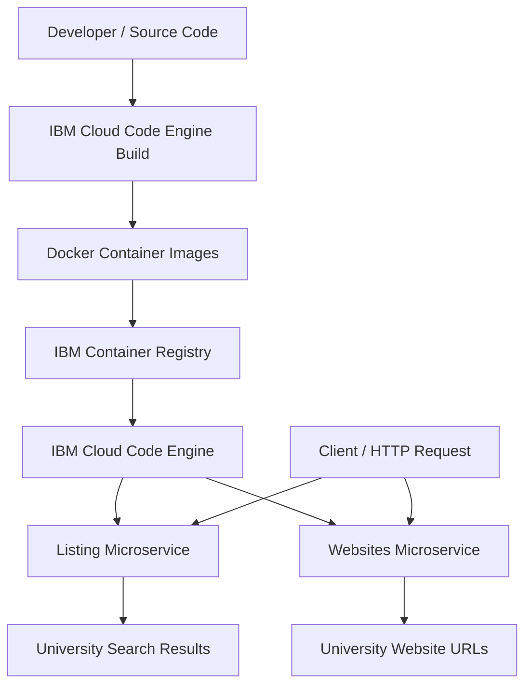

# IBM Cloud Code Engine – Microservices Deployment and Scaling


## Project Overview

This project demonstrates the deployment, configuration, testing and scaling of containerised Python Flask microservices using **IBM Cloud Code Engine**.

The project consists of two independent microservices that work with UK university information:

- **Listing Service:** Searches and retrieves information about UK universities.
- **Websites Service:** Retrieves website URLs associated with universities.

Both services are packaged as container images and deployed independently using IBM Cloud Code Engine. Images are stored in IBM Container Registry (ICR), and applications are configured with public and internal endpoints.

In addition to deployment, this project explores application revisions, instance management, minimum scaling, scale-to-zero behaviour, resource allocation and troubleshooting deployment failures caused by memory quota limitations.

This repository includes my practical deployment commands, configuration notes, experiments and troubleshooting documentation, based on the original IBM Skills Network practice project.

---

## Project Objectives

The main objectives of this project are:

- Understand microservices architecture and independent application deployment.
- Containerise Python Flask applications using Docker.
- Build container images from source code using IBM Cloud Code Engine.
- Store and manage container images using IBM Container Registry.
- Configure private registry authentication using registry secrets.
- Deploy independent microservices to IBM Cloud Code Engine.
- Understand public and internal application endpoints.
- Test application endpoints using HTTP requests and cURL.
- Configure minimum application instances to maintain availability.
- Explore autoscaling and scale-to-zero behaviour.
- Monitor application revisions and running instances.
- Understand cloud resource quotas and troubleshoot deployment failures.

---

## Architecture

The project follows a microservices architecture in which each application is independently built, deployed and scaled.



### Microservices

**1. Listing Service**

Responsible for searching and retrieving UK university information from the university dataset.

Example endpoint:

```http
GET /colleges/Trinity
```

**2. Websites Service**

Responsible for retrieving website URLs associated with matching universities.

Example endpoint:

```http
GET /websites/Trinity
```

The services are deployed independently, allowing their configurations, revisions and scaling settings to be managed separately.

### Deployment Architecture

| Component | Purpose |
|---|---|
| Python and Flask | Microservice application development |
| Docker | Application containerisation |
| IBM Cloud CLI | Cloud resource management |
| IBM Container Registry | Container image storage |
| IBM Cloud Code Engine | Application deployment and scaling |
| Registry Secret | Authentication for private container images |
| cURL | HTTP endpoint testing |

---

## Repository Structure

```text
universities/
│
├── listing/
│   ├── app.py
│   ├── Dockerfile
│   ├── requirements.txt
│   └── UK_Universities.json
│
├── websites/
│   ├── app.py
│   ├── Dockerfile
│   └── requirements.txt
│
├── docs/
│   ├── 01-ibm-cloud-setup.md
│   ├── 02-container-registry-and-deployment.md
│   ├── 03-microservices-testing.md
│   ├── 04-scaling-and-autoscaling.md
│   └── 05-troubleshooting.md
│
├── README.md
└── .gitignore
```

### Directory Description

| Directory / File | Description |
|---|---|
| `listing/` | Source code and configuration for the university listing service |
| `websites/` | Source code and configuration for the university websites service |
| `app.py` | Flask application entry point |
| `Dockerfile` | Instructions for building the application container image |
| `requirements.txt` | Python dependencies |
| `UK_Universities.json` | University dataset used by the applications |
| `docs/` | Deployment commands, scaling notes and troubleshooting documentation |
| `README.md` | Project overview and technical documentation |

---

## Technologies and Tools

| Technology | Usage |
|---|---|
| Python | Application development |
| Flask | REST-style microservice endpoints |
| Docker | Containerisation |
| IBM Cloud Code Engine | Serverless container application deployment |
| IBM Container Registry (ICR) | Container image storage |
| IBM Cloud CLI | Cloud resource and application management |
| Linux | Command-line environment |
| HTTP / cURL | API testing and application verification |
| Git and GitHub | Version control and project documentation |

---

# Practical Implementation

## 1. IBM Cloud Environment Setup

Authenticated with IBM Cloud and configured the Code Engine project using the IBM Cloud CLI.

### Login

```bash
ibmcloud login --sso
```

### Install Code Engine CLI Plugin

```bash
ibmcloud plugin install code-engine
```

### Select Code Engine Project

```bash
ibmcloud ce project select \
  --name "Code Engine - sn-labs-malikhamza05"
```

### Verify Project Configuration

```bash
ibmcloud ce project get \
  --name "Code Engine - sn-labs-malikhamza05"
```

This command provides information about project configuration, resource quotas, memory, CPU and active instances.

## 2. IBM Container Registry Configuration

Configured the IBM Container Registry namespace used to store application images.

```bash
export SN_ICR_NAMESPACE=sn-labs-malikhamza05
```

Configured the registry secret:

```text
icr-secret
```

The registry secret allows Code Engine to authenticate with the private IBM Container Registry when retrieving container images.

## 3. Deploying the Listing Microservice

Deployed the university listing application using the Code Engine build-from-source functionality.

```bash
ibmcloud ce app create \
  --name listing \
  --image us.icr.io/${SN_ICR_NAMESPACE}/listing \
  --registry-secret icr-secret \
  --port 5000 \
  --build-context-dir listing \
  --build-source .
```

### Command Explanation

| Parameter | Description |
|---|---|
| `app create` | Creates and deploys a Code Engine application |
| `--name listing` | Defines the application name |
| `--image` | Specifies the destination container image |
| `--registry-secret` | Configures registry authentication |
| `--port 5000` | Specifies the application listening port |
| `--build-context-dir listing` | Selects the listing application directory |
| `--build-source .` | Uses the current directory as the build source |

Code Engine builds the container image from the source code and Dockerfile, pushes the image to IBM Container Registry and deploys the application.

## 4. Deploying the Websites Microservice

Deployed the second Flask application independently.

```bash
ibmcloud ce app create \
  --name websites \
  --image us.icr.io/${SN_ICR_NAMESPACE}/websites \
  --registry-secret icr-secret \
  --port 5000 \
  --build-context-dir websites \
  --build-source .
```

Both applications have separate deployment configurations and can be updated or scaled independently.

## 5. Application Verification

Verified the deployment status of both microservices.

```bash
ibmcloud ce app get --name listing -q
```

```bash
ibmcloud ce app get --name websites -q
```

Checked the following deployment properties:

- Application deployment status
- Application revision
- Running instances
- Minimum and maximum scale
- Resource allocation
- Application readiness
- Public application URL

---

# Microservices Testing

## 1. Listing Service

Public application endpoint:

```text
https://listing.2h19ldutjn6f.us-south.codeengine.appdomain.cloud
```

Example request:

```bash
curl "https://listing.2h19ldutjn6f.us-south.codeengine.appdomain.cloud/colleges/Trinity"
```

This request searches for universities matching the supplied keyword.

## 2. Websites Service

Public application endpoint:

```text
https://websites.2h19ldutjn6f.us-south.codeengine.appdomain.cloud
```

Example request:

```bash
curl "https://websites.2h19ldutjn6f.us-south.codeengine.appdomain.cloud/websites/Trinity%20College%20of%20Music"
```

Keyword search example:

```bash
curl "https://websites.2h19ldutjn6f.us-south.codeengine.appdomain.cloud/websites/Trinity"
```

The keyword-search functionality uses partial university-name matching.

## 3. Internal Application Endpoints

Code Engine also provides internal service URLs for communication within the project.

**Listing Service:**

```text
http://listing.2h19ldutjn6f.svc.cluster.local
```

**Websites Service:**

```text
http://websites.2h19ldutjn6f.svc.cluster.local
```

These internal URLs allow applications in the same Code Engine project to communicate without using their public endpoints.

---

# Application Scaling and Autoscaling

Explored the scaling capabilities of IBM Cloud Code Engine by configuring minimum application instances.

## 1. Configure Listing Minimum Scale

```bash
ibmcloud ce app update --name listing --min 2
```

This configures the listing application to maintain at least two instances.

## 2. Configure Websites Minimum Scale

```bash
ibmcloud ce app update --name websites --min 2
```

This configures the websites application to maintain at least two instances.

## 3. Verify Scaling Configuration

```bash
ibmcloud ce app get --name listing -q
```

```bash
ibmcloud ce app get --name websites -q
```

Expected configuration:

```text
Minimum Scale: 2
Running Instances: 2
```

## 4. Understanding Scale-to-Zero

IBM Cloud Code Engine supports scale-to-zero behaviour.

| Minimum Scale | Behaviour |
|---|---|
| 0 | Application can scale down to zero when idle |
| 1 | At least one instance is maintained |
| 2 | At least two instances are maintained |

A minimum scale of zero can reduce idle resource consumption, but a new instance may need to start when a request arrives.

A non-zero minimum scale keeps instances available and helps reduce cold-start delays.

## 5. Horizontal Scaling

Code Engine can increase the number of application instances based on incoming workload, subject to application configuration and available project resources.

For example:

```text
Minimum Scale: 2
Maximum Scale: 10
```

This allows the application to maintain at least two instances and scale beyond that when required.

---

# Resource Management and Troubleshooting

During the scaling experiments, encountered a memory quota limitation while updating the websites application.

### Example Error

```text
Revision failed

exceeded quota: 2h19ldutjn6f

requested: requests.memory=4144857600

used: requests.memory=16579430400

limited: requests.memory=20G
```

### Investigation

Used the following command to inspect project resource consumption:

```bash
ibmcloud ce project get \
  --name "Code Engine - sn-labs-malikhamza05"
```

The project quota showed a memory limit of 20 GB.

### Troubleshooting Approach

1. Inspected application deployment status.
2. Checked application revisions.
3. Identified running and terminating instances.
4. Reviewed project memory and CPU quotas.
5. Allowed older instances to terminate.
6. Rechecked available project resources.
7. Verified application readiness after deployment.

### Key Learning

Application updates can create new revisions. During a rollout, older instances may still be terminating while new instances are being created.

This temporary overlap can increase resource requirements and cause deployments to fail when the project quota is insufficient.

This exercise provided practical experience in cloud resource management, application lifecycle management and deployment troubleshooting.

---

# Key Learning Outcomes

Through this project, I gained practical experience with:

- Deploying independent containerised microservices.
- Working with Python Flask applications.
- Understanding Dockerfiles and container images.
- Building container images from source using IBM Cloud Code Engine.
- Managing images through IBM Container Registry.
- Configuring registry authentication.
- Deploying and testing public HTTP endpoints.
- Understanding internal service discovery.
- Managing application revisions.
- Configuring minimum application instances.
- Understanding autoscaling and scale-to-zero.
- Monitoring application readiness and running instances.
- Investigating resource allocation and memory quota errors.
- Troubleshooting deployment and scaling failures.

---

# Future Improvements

Potential improvements to extend this project:

- Implement CI/CD pipelines using GitHub Actions.
- Add health-check and monitoring endpoints.
- Implement automated API testing.
- Introduce structured logging and monitoring.
- Add Infrastructure as Code using Terraform.
- Implement authentication and API security.
- Improve error handling and input validation.
- Explore service-to-service communication and resilience patterns.

---

# Documentation

Additional practical notes and command references are available in the `docs/` directory:

| Document | Contents |
|---|---|
| [IBM Cloud Setup](docs/01-ibm-cloud-setup.md) | CLI installation and project configuration |
| [Container Registry and Deployment](docs/02-container-registry-and-deployment.md) | Image building and application deployment |
| [Microservices Testing](docs/03-microservices-testing.md) | Endpoint testing and internal URLs |
| [Scaling and Autoscaling](docs/04-scaling-and-autoscaling.md) | Minimum instances and autoscaling |
| [Troubleshooting](docs/05-troubleshooting.md) | Memory quota and revision management |

---

# Original Learning Resource and Attribution

This project is based on the IBM Skills Network microservices practice project:

[IBM Developer Skills Network – Microservices Practice Project](https://github.com/ibm-developer-skills-network/gentu-microservices_practiceProj)

The repository contains my practical deployment notes, commands, experiments and additional documentation.

Original source code and learning materials are attributed to their respective authors.

---

## Author

**Muhammad Hamza**

DevOps and Cloud Engineering | Containerisation | Kubernetes | Docker | IBM Cloud

GitHub: [malikhamza0546](https://github.com/malikhamza0546)

